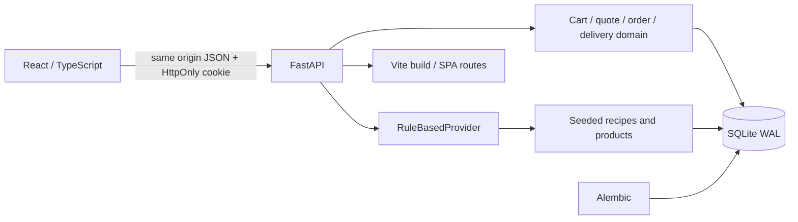
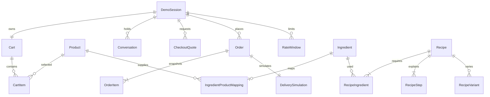

# Architecture

The demo implements the original Vietnamese concept brief without a real payment, LLM, supplier integration or robot. React/TypeScript renders the mobile-first interface. FastAPI is authoritative for integer VND totals, package rounding, cart versions, quotes, ownership and delivery state. SQLAlchemy uses SQLite; Alembic owns schema changes. Seed data is idempotent. All timestamps are UTC seconds; delivery input carries an explicit offset and the UI displays Vietnam time.

One process serves static assets and `/api/v1`. Development Vite proxies API calls to port 8000. Rendering never requires a third-party request; icons are bundled and illustration is inline SVG. Swagger documentation alone loads external CDN assets. A public Render service will reseed after ephemeral-disk loss; the client explicitly offers a new session when an old cookie no longer exists.

## Data model

`Order.quote_id` is unique but intentionally not an FK: expired quotes are deleted while order snapshots survive. Order items preserve product names and prices; product deletion cannot rewrite history. Session deletion cascades through carts, conversations, quotes, orders, delivery and rate windows. Ingredient mappings use canonical units; incompatible units fail rather than silently convert grams to milliliters. A meal is a seeded recipe-ID grouping, not a separate purchasing entity.

## Critical invariants

- All short writes take `BEGIN IMMEDIATE` before reads; cart writes compare `expected_version`. Stale tabs get a conflict rather than a silent overwrite.
- Function-scoped database dependencies commit before response headers and cookies are published. A middleware-level regression verifies visibility from a separate DB connection.
- Recipe quantities scale by servings, aggregate across dishes, then round up to sale packs. Selected ingredients alone enter the cart.
- Checkout quotes expire after ten minutes and bind cart version, product snapshot fingerprint and schedule. Orders validate them again and use session-scoped idempotency keys.
- Delivery state derives from start time plus an explicit simulation offset. Scheduled orders remain waiting until their simulated window; refresh does not restart delivery.
- Sessions have random opaque HttpOnly, SameSite=Lax cookies; Secure is enabled on Render. Origin checks reject cross-site writes. There is no account authentication or claim of production-grade abuse prevention.
- Request logs omit bodies, query strings, addresses and cookie values. Expired demo data is purged lazily during API calls. Rate limits are per session, not an anti-bot barrier.

## Boundaries and risks

SQLite serializes writes and is suitable for this single-instance demo. No queue or WebSocket is needed for deterministic delivery polling. Free hosting restarts lose all sessions and orders; no persistent disk is configured. Actual multi-tenant production would require identity, durable storage, privacy policy, observability, supplier integration, professionally reviewed food content and building/robot feasibility work.

API schema: [openapi.json](openapi.json). Decisions: [stack](adr/001-stack.md), [assistant](adr/002-assistant.md), [session and persistence](adr/003-persistence.md).
